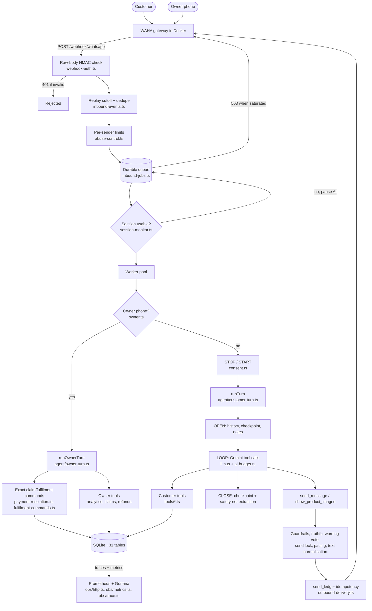

# WhatsApp Shop Agent

AI sales agent for a Pakistani clothing shop on WhatsApp — English + Roman
Urdu, real orders and double-entry ledger, with the LLM kept on a short leash
by deterministic code.


**Live demo:** [ahmed-assistant-portfolio.onrender.com](https://ahmed-assistant-portfolio.onrender.com)
(free tier — first load takes ~45 seconds). Read-only, synthetic data, no
model calls — see [Portfolio demo](docs/SETUP.md#6-portfolio-demo).

<!-- DEMO VIDEO: add link here -->

A single-tenant WhatsApp AI sales assistant for one clothing/footwear shop in
Pakistan. One business, one WhatsApp number, one owner, no staff. It replies
to customers in English and Roman Urdu using only approved shop data,
remembers customers across days, keeps the books (orders, stock, double-entry
ledger, payment claims, refund review cases), and lets the owner run the shop
and query it from his own phone — all while a non-deterministic LLM is kept
on a short, fully-guarded leash around deterministic backend code that owns
every price, total, status change and payment resolution.

Stack: Node 24 LTS, TypeScript (strict), Express, SQLite via `better-sqlite3`
12.10.0, Google Gemini over raw REST (`gemini-flash-lite-latest`), and
[WAHA](https://waha.devlike.pro/) (an unofficial WhatsApp Web HTTP gateway run
in Docker). No other runtime dependencies.

## Engineering highlights

- **The model proposes, fixed code disposes.** Every price, stock check,
  order total, FSM transition and payment/refund resolution is computed and
  authorized by deterministic backend code; the model's plain text is
  discarded and only a guarded `send_message` tool call can ever reach a
  customer.
- **Financial correctness.** Integer-paisa money, balances derived from a
  `ledger` table (never a stored balance column), atomic stock reservation,
  append-only audit trails, and SQLite triggers that physically forbid
  editing or deleting verified payment/refund history.
- **Security-first by default.** Raw-body HMAC-verified webhooks, replay
  quarantine and provider-event dedupe, per-sender rate limiting, trust
  envelopes around every piece of untrusted stored/tool data, and fail-closed
  configuration everywhere — a missing secret disables the feature, it never
  silently widens access.
- **Operational maturity.** A durable, at-least-once inbound job queue with a
  worker pool and crash/restart recovery; verified online SQLite backups with
  `integrity_check`/`foreign_key_check` on every run; Prometheus metrics,
  a Grafana dashboard and per-message trace tables, with tests that scan
  every trace row and every byte of `/metrics` for leaked phone numbers or
  message text.
- **Test discipline.** Every test file runs against its own throwaway
  temporary database, with the real production database fingerprinted
  before and after every run so a test cannot touch real data even by
  accident. A maintained manifest maps every file to the specific security
  property it proves.
- **Honest status tracking.** One canonical roadmap distinguishes `BUILT`
  from `LOCALLY VERIFIED` from `LIVE VERIFIED` — nothing is marked done until
  it has actually passed against the real WhatsApp number or a deterministic
  test at the real security boundary.

## Results

- **39 test files, 57 declared security areas, all passing** (`npm test`,
  last run 2026-11-07) — `scripts/test-manifest.ts` maps every file to the
  property it proves.
- **Live-verified on the real WhatsApp number:** V1 — talks to customers and
  remembers them (2026-09-05); V2 — orders, stock, ledger, payment claims
  (2026-09-14); V3 — owner Q&A and WhatsApp owner alerts (2026-09-15).
- **Built and locally verified, live acceptance still pending:** the
  HARD-01–07 security/ops hardening backlog (abuse limits, injection
  defence, outbound idempotency, durable queue, backups, monitoring) and the
  Prometheus/Grafana observability stack. See
  [docs/ENGINEERING_ROADMAP.md](docs/ENGINEERING_ROADMAP.md) for the
  itemised, current status of every area.

## Status

| Area | Status |
|---|---|
| V1 — talks to customers and remembers them | Done, live-verified on the real number |
| V2 — keeps the books (orders, stock, ledger, payment claims) | Done, live-verified |
| V3 — owner Q&A and WhatsApp owner alerts | Done, live-verified |
| Real-business hardening (fulfilment, STOP/START, webhook HMAC, payment claims, refunds, PII, identity) | Built, locally verified |
| Security/ops backlog HARD-01–07 (abuse limits, injection defence, outbound idempotency, durable queue, backups, monitoring) | Built + locally verified; live WhatsApp acceptance in progress |
| Observability — Prometheus metrics, Grafana dashboard, per-message traces | Built + locally verified; first live start pending |
| Official WhatsApp API migration, real-shop pilot, multi-business support | Decision required / not started (see roadmap) |

**This project is not approved for an unattended real-shop launch.** The
inventory and policy text are demonstration data, and WAHA is an unofficial
WhatsApp Web bridge with real account-ban risk — a documented, deliberate
decision point (`HARD-13`), not an oversight. The canonical, itemised status
lives in [docs/ENGINEERING_ROADMAP.md](docs/ENGINEERING_ROADMAP.md).

## Architecture



Component and workflow detail: [docs/SYSTEM_ARCHITECTURE.md](docs/SYSTEM_ARCHITECTURE.md)
and [docs/ARCHITECTURE_GUIDELINES.md](docs/ARCHITECTURE_GUIDELINES.md).

## Quick start

```bash
git clone https://github.com/FarhanUllah382/whatsapp-shop-agent.git && cd whatsapp-shop-agent
npm ci && cp .env.example .env   # fill in required keys — see docs/SETUP.md
npm run seed && npm run dev      # seed products, run on port 3000
```

Full setup (WAHA, Docker, backups, env-variable reference, project layout):
[docs/SETUP.md](docs/SETUP.md).

## Testing

```bash
npm run typecheck      # tsc --noEmit
npm test               # all test files, each against its own temporary database
npm run test:security  # the security manifest, printing each file's protection areas
npm run test:e2e       # Version 2 order/ledger end-to-end flow
```

The runner fingerprints `ahmed.db` and its SQLite sidecars before and after
every run and fails if they change. Test entry points refuse to open
`ahmed.db` directly, so running a test file with `npx tsx` outside the runner
fails on purpose; always use the npm scripts above.

## Limitations

- **WAHA is an unofficial WhatsApp Web bridge** — real account-ban risk on
  the linked number. Moving to the official WhatsApp Cloud API for a real
  client is a deliberate, still-open decision (`HARD-13`).
- **Single-tenant by design.** No organization scoping, no multi-business
  support — a different architecture, not an increment to this repo.
- **Demo inventory and policy text.** The product catalog and prices are
  illustrative, not a real shop's live stock.
- **Not approved for an unattended real-shop launch.** See the Status table
  and [docs/ENGINEERING_ROADMAP.md](docs/ENGINEERING_ROADMAP.md) for exactly
  what is live-verified versus still pending.

## Documentation

- [CLAUDE.md](CLAUDE.md): entry point, working rules, conventions, file map
- [docs/SETUP.md](docs/SETUP.md): full local setup, Docker, backups, project structure
- [docs/ENGINEERING_ROADMAP.md](docs/ENGINEERING_ROADMAP.md): the only canonical status tracker
- [docs/SYSTEM_ARCHITECTURE.md](docs/SYSTEM_ARCHITECTURE.md): component and workflow detail
- [docs/ARCHITECTURE_GUIDELINES.md](docs/ARCHITECTURE_GUIDELINES.md): engineering principles
- [docs/OPERATIONS_RUNBOOK.md](docs/OPERATIONS_RUNBOOK.md): health checks, backup/restore, incidents
- [docs/OBSERVABILITY.md](docs/OBSERVABILITY.md): Prometheus/Grafana/trace setup and privacy rules
- [docs/HARD-01_LIVE_CHECKLIST.md](docs/HARD-01_LIVE_CHECKLIST.md): live WhatsApp acceptance checklist
- [docs/REAL_BUSINESS_PRODUCTION_READINESS.md](docs/REAL_BUSINESS_PRODUCTION_READINESS.md): readiness specification
- [docs/INVENTORY_CSV_GUIDE.md](docs/INVENTORY_CSV_GUIDE.md): inventory CSV format

## License

Licensed under the [MIT License](LICENSE).
