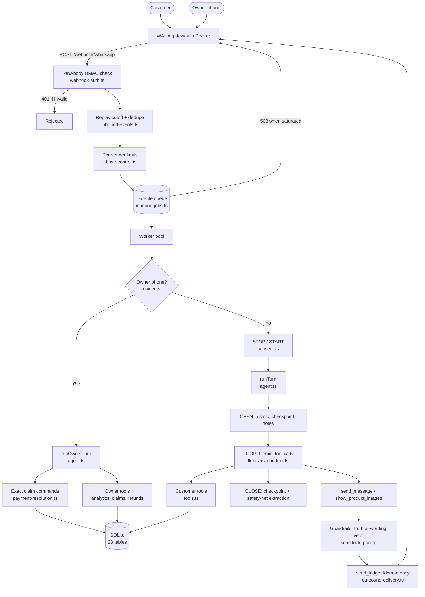

# Ahmed's WhatsApp Assistant

A single-shop WhatsApp AI sales assistant for one clothing/footwear shop in
Pakistan. One business, one WhatsApp number, one owner, no staff. It replies
to customers in English and Roman Urdu using approved shop data, remembers
customers across days, keeps the books (orders, stock, ledger, payment claims,
refund review cases), and lets the owner ask business questions from his own
phone.

Stack: Node 24 LTS, TypeScript (strict), Express, SQLite via `better-sqlite3`
12.10.0, Google Gemini over REST (`gemini-flash-lite-latest`), and
[WAHA](https://waha.devlike.pro/) (an unofficial WhatsApp Web HTTP gateway run
in Docker).

## Status

| Area | Status |
|---|---|
| Version 1: talks to customers and remembers them | Done, live-verified on the real number (Sep 2026) |
| Version 2: keeps the books (orders, stock, ledger, payment claims) | Done, live-verified (Sep 2026) |
| Version 3: owner Q&A and WhatsApp owner alerts | Done, live-verified (Sep 2026) |
| Security and operations hardening (HARD-02 to HARD-07: confirmation wording, abuse/AI-cost limits, injection defence, outbound idempotency, job queue, backups, monitoring) | Built and locally verified by deterministic tests |
| HARD-01: live WhatsApp acceptance pass of the hardened build | **Pending** |
| Privacy lifecycle, commercial totals, payment/refund execution, official WhatsApp API, real-shop pilot | Partial, owner decisions required, or not started |

**This project is not approved for an unattended real-shop launch.** The
hardened build has not yet passed its live acceptance checklist (HARD-01), the
inventory and policy text are demonstration data, and WAHA is an unofficial
WhatsApp Web bridge with account-ban risk. The canonical, itemised status is
in [docs/ENGINEERING_ROADMAP.md](docs/ENGINEERING_ROADMAP.md).

## What it does

### Customer conversations
- Answers product, stock and policy questions from the product table and the
  owner-approved [catalog.md](catalog.md). Policy answers fail closed if the
  file's SHA-256 does not match `APPROVED_CATALOG_SHA256`. Unknown attributes
  and unsupported questions are handed off to the owner instead of guessed.
- Remembers customers across days through conversation checkpoints and
  durable customer notes.
- Shows public stock only as availability bands or a yes/no for a requested
  quantity; exact stock counts stay private.
- Sends up to three product image cards per reply (`show_product_images`)
  from `assets/product-images/` when a customer asks for pictures.
- Refuses unauthorised discounts and blocks replies that promise human
  actions which were not actually recorded.

### Orders and bookkeeping
- **Two-step order confirmation.** `prepare_order` shows a server-computed
  summary. Only a *later* inbound message with explicit wording about
  confirming, booking or placing the order books it. Bare "yes", "ok",
  "haan", "ji", "okay" or "done" is rejected. Price and stock are rechecked
  and booking is atomic.
- Prices come from the database, never from the model. Money is stored as
  integer paisa.
- Forward-only order state machine
  `placed -> confirmed -> paid -> shipped -> delivered`, with cancellation only
  before shipping, actor-specific permissions, and an append-only
  `order_status_events` audit trail.
- Balances are derived from the `ledger` table (sum of debits minus credits);
  there is no stored balance column.
- Order references are high-entropy and bound to the sender's WhatsApp
  number; another customer's order and a nonexistent order produce the same
  response.

### Payments and refunds
- Customers can only create **unverified** payment claims. The model has no
  tool that resolves a claim or credits money.
- The owner approves a claim with an exact two-step text command that
  includes the transaction reference he checked in the business account:

  ```
  APPROVE CLAIM 12 REF TXN123456
  CONFIRM APPROVE CLAIM 12 REF TXN123456
  ```

  Rejection and reversal use `REJECT CLAIM <id>` / `CONFIRM REJECT CLAIM <id>`
  and `REVERSE CLAIM <id>` / `CONFIRM REVERSE CLAIM <id>`. Natural-language
  approval changes nothing. Approval checks duplicate references, amount,
  order and balance; SQLite triggers require an exactly linked ledger credit
  and forbid editing or deleting verification and audit history. Reversal
  writes a compensating debit.
- Payment methods other than cash on delivery stay unavailable until their
  `PAYMENT_*` destinations are configured.
- Refund requests on delivered orders create a **review case** only. The
  owner approves or rejects it; no money moves automatically, and the
  assistant may not claim a refund was paid.

### Owner mode
- Messages from `AHMED_OWNER_PHONE` (fail-closed if unset) go to a separate
  owner assistant with report tools: `inventory_overview`, `sales_today`,
  `unpaid_customers`, `top_selling_product`, `pending_followups`,
  `pending_payment_claims`, `pending_refund_requests`,
  `resolve_refund_request`.
- Owner alerts (handoffs, reply failures, unlogged orders/payments, new
  payment claims, refund requests) are delivered over
  WhatsApp with a flood limit; excess alerts are kept and retried.

### Safety and operations
- **Consent:** `STOP` (and Roman Urdu equivalents such as `messages band
  karo`) stops automated messages; `START` restores them. These commands
  bypass rate limits so a customer can always opt out.
- **Webhook HMAC:** every `POST /webhook/whatsapp` is verified against the
  raw body with an HMAC-SHA512 shared secret (`WAHA_WEBHOOK_HMAC_KEY`, set as
  `WHATSAPP_HOOK_HMAC_KEY` in WAHA). Missing or invalid signatures get HTTP 401.
- **Replay quarantine:** messages older than the stored replay cutoff (advanced
  at every start, optional `INBOUND_ACCEPT_AFTER`) are acknowledged but never
  processed, and provider events are deduplicated.
- **Durable inbound queue:** accepted messages are committed to SQLite before
  WAHA gets HTTP 200, processed by a worker pool (default 4 workers, 500
  pending, lease and retry), resumed after restart, and answered with HTTP 503
  when saturated.
- **Abuse limits:** durable per-sender turn limits (default 20 customer / 60
  owner turns per 10 minutes) and a deterministic busy reply with cooldown.
- **AI daily budget:** a shared daily Gemini call and token cap on the
  Karachi business day (defaults 500 calls / 500,000 tokens).
- **Outbound controls:** the model's plain text is discarded; only the
  `send_message` tool reaches a customer, after guardrails, a send lock,
  anti-ban pacing (warm-up cap, sending window, jitter, repetition check) and
  `send_ledger` idempotency.
- **Untrusted data and truthful wording:** stored text and tool results are
  wrapped as untrusted data; replies that falsely claim a payment was
  verified, a refund paid, or the owner viewed something are vetoed.
- **PII redaction:** structured logs are redacted, model-visible contact
  details are masked, and owner alerts are sanitised.
- **Backups:** a verified online SQLite backup at startup and every 24 hours
  (retain 14), each checked with `integrity_check` and `foreign_key_check`.
- **Health endpoints:** `GET /health` (process alive), `GET /ready` (SQLite and
  WAHA session ready, else 503), and `GET /operations/metrics` (queue and
  delivery counts, requires the `X-Operations-Key` header matching
  `OPERATIONS_API_KEY` of at least 24 characters; otherwise 401).

## Architecture



More detail: [docs/SYSTEM_ARCHITECTURE.md](docs/SYSTEM_ARCHITECTURE.md) and
[docs/ARCHITECTURE_GUIDELINES.md](docs/ARCHITECTURE_GUIDELINES.md).

## Project structure

```
catalog.md                    Owner-approved policy/FAQ text (hash-checked)
db/schema.sql                 SQLite schema: 28 tables, triggers, indexes
assets/product-images/        Product images used by show_product_images
Dockerfile                    Two-stage Node 24 image (runs dist/server.js)
render.yaml                   Render config for the portfolio demo
src/
  server.ts                   Express entry: /health, /ready, /operations/metrics, /webhook/whatsapp
  agent.ts                    runTurn / runOwnerTurn, prompts, send guardrails
  tools.ts                    Customer and owner tools with server-side validation
  llm.ts                      The single Gemini seam (callModel)
  db.ts                       SQLite connection and startup migrations
  types.ts                    Shared types
  orders.ts                   Order state machine, atomic stock reservation
  order-access.ts             Sender-bound order lookup and throttling
  order-summary.ts            Server-computed order summaries
  inventory.ts                Stock and product queries
  inventory-visibility.ts     Public availability bands
  catalog.ts                  catalog.md loading and hash check
  business-grounding.ts       Grounded product/policy answers
  ledger.ts  money.ts         Derived balances, integer-paisa money
  payments.ts                 Unverified payment claims
  payment-resolution.ts       Owner APPROVE/REJECT/REVERSE CLAIM commands
  payment-instructions.ts     Configured payment destinations
  refunds.ts                  Refund review cases
  consent.ts                  STOP / START opt-out and opt-in
  privacy.ts                  PII masking and redaction helpers
  untrusted-data.ts           Trust envelopes for stored/tool data
  sensitive-action-wording.ts Fixed wording for payment/refund/status outcomes
  handoff-claims.ts           Truthful handoff reporting
  customer-reply-safety.ts    Final customer-reply veto checks
  alerts.ts                   Owner WhatsApp alerts with flood limit
  followups.ts  analytics.ts  Owner report definitions
  owner.ts                    Fail-closed owner phone check
  inbound-events.ts           Replay cutoff and provider-event dedupe
  inbound-jobs.ts             Durable inbound job queue and workers
  abuse-control.ts            Per-sender turn limits
  ai-budget.ts                Daily model call/token budget
  busy-reply.ts               Deterministic overload reply
  outbound-delivery.ts        send_ledger idempotency and delivery state
  operations.ts               Health, readiness, metrics
  database-backup.ts          Verified SQLite backups and retention
  product-media.ts            Product image cards
  webhook-auth.ts             WAHA webhook HMAC verification
  channel/types.ts            ChannelAdapter interface
  channel/waha.ts             WahaAdapter
  guardrails/                 discount-rules, human-promise, messaging-window, pacing/, spinning/
  obs/logger.ts               Redacting structured logger
scripts/
  run-isolated-tests.ts       Test runner: temp DB per file, production DB fingerprint
  test-manifest.ts            Test files and declared security areas
  test-v2-flow.ts             Version 2 end-to-end flow (run via npm run test:e2e)
  seed-catalog.ts             Seed products
  import-inventory.ts         CSV inventory import
  backup-database.ts          Manual verified backup
  verify-database-backup.ts   Verify a backup file
  verify-product-media.ts     Check product images
  repair-legacy-payment-claim.ts  One-off audited claim repair
  seed-portfolio-demo.ts  build-portfolio-demo.ts  verify-portfolio-demo.ts
tests/                        27 test files listed in scripts/test-manifest.ts
docs/                         Tracker, architecture, runbook, readiness spec, CSV guide
```

### Database

`db/schema.sql` defines 28 tables: `customers`, `customer_consent_events`,
`products`, `orders`, `order_lookup_attempts`, `order_drafts`,
`order_status_events`, `ledger`, `messages`, `checkpoints`, `send_ledger`,
`bookkeeping_receipts`, `payment_claims`, `payment_claim_action_intents`,
`payment_claim_verifications`, `payment_claim_events`,
`payment_claim_ledger_links`, `refund_requests`, `inbound_guard_state`,
`inbound_events`, `inbound_jobs`, `inbound_abuse_events`, `ai_model_calls`,
`customer_notes`, `privacy_migrations`, `handoff_ledger`, `owner_alerts`,
`owner_alert_events`.

The real database (`ahmed.db`) is gitignored and must never be committed.

## Setup

### Prerequisites
- Node.js 24 LTS (see `.nvmrc`; `package.json` requires `>=24 <25`)
- Docker (for WAHA)
- A Google Gemini API key from [Google AI Studio](https://aistudio.google.com/)
- A WhatsApp number you are allowed to link to WAHA (expect ban risk on new
  or heavily used numbers)

### 1. Install

```bash
git clone https://github.com/FarhanUllah382/Whattsapp-Assisstant.git
cd Whattsapp-Assisstant
npm ci
```

### 2. Configure

```bash
cp .env.example .env
```

Every variable is documented in [.env.example](.env.example). Required for a
real run (each feature fails closed when its value is missing):

| Variable | Purpose |
|---|---|
| `GEMINI_API_KEY` | Gemini API credential |
| `WAHA_BASE_URL` | WAHA URL, e.g. `http://localhost:3001` |
| `WAHA_SESSION` | WAHA session name, e.g. `default` |
| `WAHA_API_KEY` | WAHA API key |
| `WAHA_WEBHOOK_HMAC_KEY` | Long random webhook secret; same value as WAHA's `WHATSAPP_HOOK_HMAC_KEY` |
| `AHMED_OWNER_PHONE` | Owner number in E.164 digits, e.g. `923001234567` |
| `APPROVED_CATALOG_SHA256` | SHA-256 of the approved `catalog.md` |
| `PACING_NUMBER_ACTIVATED_ON` | Date the sending number was activated (drives the warm-up cap) |
| `OPERATIONS_API_KEY` | Separate key for `/operations/metrics`, at least 24 characters |

Optional, with finite defaults: `PORT`, `PACING_TIMEZONE`,
`PACING_WINDOW_END_HOUR`, `INBOUND_ACCEPT_AFTER`,
`INBOUND_RATE_WINDOW_MINUTES`, `INBOUND_CUSTOMER_TURNS_PER_WINDOW`,
`INBOUND_OWNER_TURNS_PER_WINDOW`, `AI_BUDGET_TIMEZONE`, `AI_DAILY_CALL_LIMIT`,
`AI_DAILY_TOKEN_LIMIT`, `INBOUND_JOB_WORKERS`, `INBOUND_JOB_MAX_PENDING`,
`INBOUND_JOB_LEASE_SECONDS`, `INBOUND_JOB_MAX_ATTEMPTS`,
`INBOUND_JOB_RETRY_BASE_SECONDS`, `DATABASE_BACKUP_ENABLED`,
`DATABASE_BACKUP_DIRECTORY`, `DATABASE_BACKUP_INTERVAL_HOURS`,
`DATABASE_BACKUP_RETENTION_COUNT`, `OWNER_ALERT_WINDOW_MINUTES`,
`OWNER_ALERT_MAX_SENDS_PER_WINDOW`, `BUSY_REPLY_COOLDOWN_MINUTES`.

Payment destinations (`PAYMENT_EASYPAISA_*`, `PAYMENT_JAZZCASH_*`,
`PAYMENT_BANK_*`) stay blank until the owner provides real details; blank
methods are not offered. Never commit real numbers, keys or account details.

After any edit to `catalog.md`, recompute its hash and update
`APPROVED_CATALOG_SHA256`:

```bash
sha256sum catalog.md
```

### 3. Start WAHA

```bash
docker run -it --name waha -p 3001:3001 \
  -e WHATSAPP_HOOK_URL=http://host.docker.internal:3000/webhook/whatsapp \
  -e WHATSAPP_HOOK_EVENTS=message \
  -e WHATSAPP_HOOK_HMAC_KEY=<same value as WAHA_WEBHOOK_HMAC_KEY> \
  devlikeapro/waha
```

Open `http://localhost:3001`, link the WhatsApp number, and keep the WAHA
session volume. Deleting it forces a relink and can replay message history.
Configure the WAHA API key to match `WAHA_API_KEY` as described in the WAHA
documentation.

### 4. Seed and run

```bash
npm run seed       # seed products
npm run dev        # loads .env and runs src/server.ts on port 3000
```

Or compiled:

```bash
npm run build
npm start          # node dist/server.js
```

Import a real inventory CSV with
`npx tsx scripts/import-inventory.ts <file.csv>`; see
[docs/INVENTORY_CSV_GUIDE.md](docs/INVENTORY_CSV_GUIDE.md).

Check the service:

```bash
curl http://localhost:3000/health
curl http://localhost:3000/ready
curl -H "X-Operations-Key: $OPERATIONS_API_KEY" http://localhost:3000/operations/metrics
```

## Testing

```bash
npm run typecheck      # tsc --noEmit
npm test               # all 27 test files, each against its own temporary database
npm run test:security  # the security manifest, printing each file's protection areas
npm run test:e2e       # Version 2 order/ledger end-to-end flow
```

The runner fingerprints `ahmed.db` and its SQLite sidecars before and after
every run and fails if they change. Test entry points refuse to open
`ahmed.db` directly, so running a test file with `npx tsx` outside the runner
fails on purpose; always use the npm scripts above.

## Backups

```bash
npm run backup                                    # create a verified backup now
npm run backup:verify -- /absolute/path/to/backup.db
npm run catalog:verify-media                      # check product image files
```

Restore steps and incident procedures are in
[docs/OPERATIONS_RUNBOOK.md](docs/OPERATIONS_RUNBOOK.md).

## Docker

The `Dockerfile` builds a two-stage Node 24 image that compiles TypeScript and
runs `npm start` on port 3000. It copies `catalog.md`, `db/schema.sql` and
`assets/product-images/` into the image.

```bash
docker build -t ahmed-assistant .
docker run --env-file .env -p 3000:3000 \
  -v "$(pwd)/ahmed.db:/app/ahmed.db" \
  -v "$(pwd)/backups:/app/backups" \
  ahmed-assistant
```

The database path is fixed at `ahmed.db` in the project root (`/app/ahmed.db`
in the image), so mount it and the backup directory to keep data across
container restarts. Create an empty `ahmed.db` file first if it does not exist,
otherwise Docker creates a directory at that path. WAHA still runs as its own
container; point `WAHA_BASE_URL` and WAHA's `WHATSAPP_HOOK_URL` at addresses
both containers can reach. The repository does not include a managed
production deployment or process supervisor.

## Portfolio demo

A separate, demo-only build uses seeded fake data and is configured for Render
in `render.yaml`:

```bash
npm run demo:build    # seed demo data and assemble .portfolio-runtime/
npm run demo:start    # run the demo server
npm run demo:verify   # check the demo build
```

These scripts read from a `portfolio-demo/` source folder, which is currently
missing from the working copy, so `demo:build` fails until it is restored.

## Documentation

- [CLAUDE.md](CLAUDE.md): entry point, working rules, conventions, file map
- [docs/ENGINEERING_ROADMAP.md](docs/ENGINEERING_ROADMAP.md): the only canonical status tracker
- [docs/SYSTEM_ARCHITECTURE.md](docs/SYSTEM_ARCHITECTURE.md): component and workflow detail
- [docs/ARCHITECTURE_GUIDELINES.md](docs/ARCHITECTURE_GUIDELINES.md): engineering principles
- [docs/OPERATIONS_RUNBOOK.md](docs/OPERATIONS_RUNBOOK.md): health checks, backup/restore, incidents
- [docs/REAL_BUSINESS_PRODUCTION_READINESS.md](docs/REAL_BUSINESS_PRODUCTION_READINESS.md): readiness specification
- [docs/INVENTORY_CSV_GUIDE.md](docs/INVENTORY_CSV_GUIDE.md): inventory CSV format

## License

Licensed under the [MIT License](LICENSE).
